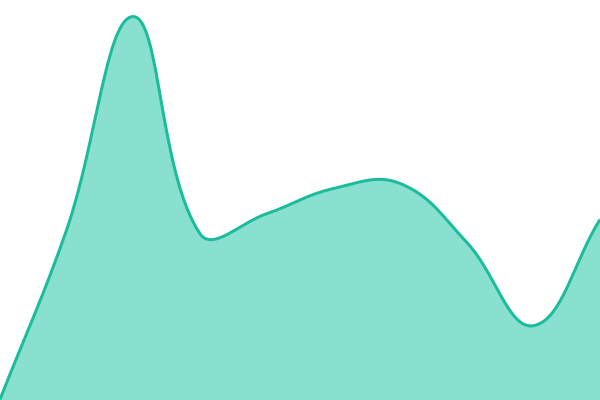
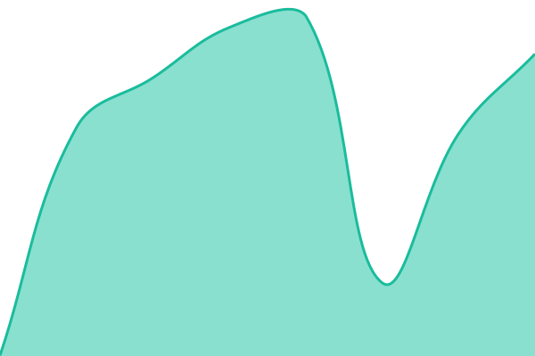
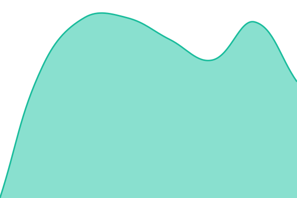
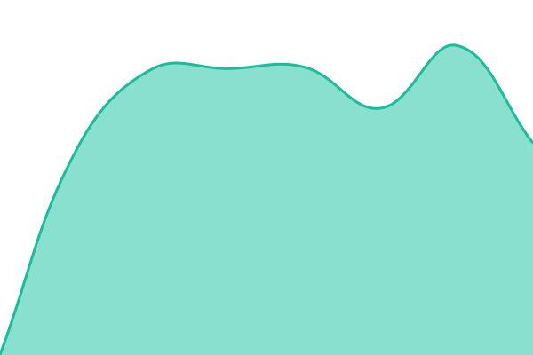
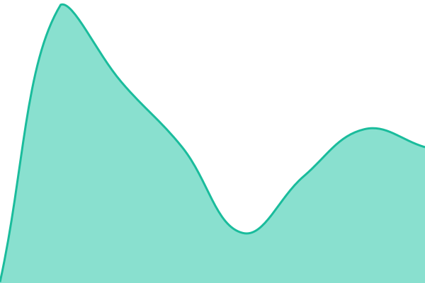
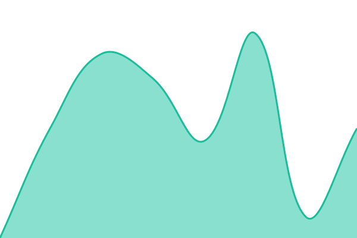
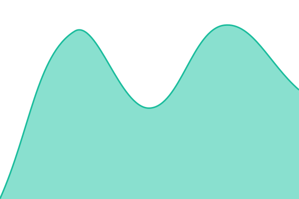
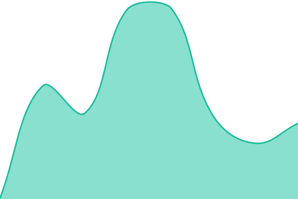
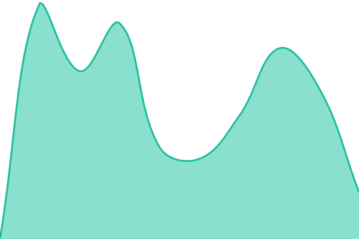

# Open Waters status

Uptime monitor and status page for [Open Waters](https://openwaters.io) services, powered by [Upptime](https://upptime.js.org) on GitHub Actions, Issues, and Pages. The page is at [status.openwaters.io](https://status.openwaters.io); downtime opens an issue here.

Monitors live in [.upptimerc.yml](.upptimerc.yml), named by service (Website, AIS, Tides API, Charts, Crowd depth) because Upptime has no sections; each keeps a fixed `slug` so renaming one doesn't drop its history. `AIS · Stream` checks `https://ais.openwaters.io/health`, which is 503 when an open-feed upstream is silent or the server's own subscriber stops receiving events, so it covers delivery, not just reachability.

<!--start: status pages-->
<!-- This summary is generated by Upptime (https://github.com/upptime/upptime) -->
<!-- Do not edit this manually, your changes will be overwritten -->
<!-- prettier-ignore -->
| URL | Status | History | Response Time | Uptime |
| --- | ------ | ------- | ------------- | ------ |
|  [Website · openwaters.io](https://openwaters.io) | 🟩 Up | [openwaters-io.yml](https://github.com/openwatersio/status/commits/HEAD/history/openwaters-io.yml) | 

 277ms
     
 | 

<a href="https://status.openwaters.io/history/openwaters-io">100.00%</a>
    

|  [Website · slackwater.xyz](https://slackwater.xyz) | 🟩 Up | [slackwater-xyz.yml](https://github.com/openwatersio/status/commits/HEAD/history/slackwater-xyz.yml) | 

 498ms
     
 | 

<a href="https://status.openwaters.io/history/slackwater-xyz">100.00%</a>
    

|  [AIS · Stream](https://ais.openwaters.io/health) | 🟩 Up | [ais-stream.yml](https://github.com/openwatersio/status/commits/HEAD/history/ais-stream.yml) | 

 543ms
     
 | 

<a href="https://status.openwaters.io/history/ais-stream">100.00%</a>
    

|  [AIS · WebSocket](wss://ais.openwaters.io/v1/stream) | 🟩 Up | [ais-web-socket.yml](https://github.com/openwatersio/status/commits/HEAD/history/ais-web-socket.yml) | 

 0ms
     
 | 

<a href="https://status.openwaters.io/history/ais-web-socket">100.00%</a>
    

|  [AIS · Vessels API](https://ais.openwaters.io/v1/vessels?bbox=59,10,60,11) | 🟩 Up | [ais-vessels-snapshot.yml](https://github.com/openwatersio/status/commits/HEAD/history/ais-vessels-snapshot.yml) | 

 1092ms
     
 | 

<a href="https://status.openwaters.io/history/ais-vessels-snapshot">100.00%</a>
    

|  [AIS · Vessel tiles](https://ais.openwaters.io/v1/vessels/tiles/6/33/18) | 🟩 Up | [ais-vessel-tiles.yml](https://github.com/openwatersio/status/commits/HEAD/history/ais-vessel-tiles.yml) | 

 885ms
     
 | 

<a href="https://status.openwaters.io/history/ais-vessel-tiles">100.00%</a>
    

|  [AIS · MCP server](https://ais.openwaters.io/mcp) | 🟩 Up | [ais-mcp-server.yml](https://github.com/openwatersio/status/commits/HEAD/history/ais-mcp-server.yml) | 

 735ms
     
 | 

<a href="https://status.openwaters.io/history/ais-mcp-server">100.00%</a>
    

|  [AIS · Live map](https://openwaters.io/ais/vessels) | 🟩 Up | [ais-live-map.yml](https://github.com/openwatersio/status/commits/HEAD/history/ais-live-map.yml) | 

 242ms
     
 | 

<a href="https://status.openwaters.io/history/ais-live-map">100.00%</a>
    

|  [Tides API · Tide extremes](https://api.openwaters.io/tides/extremes?latitude=26.772&longitude=-80.05) | 🟩 Up | [tides-api-extremes.yml](https://github.com/openwatersio/status/commits/HEAD/history/tides-api-extremes.yml) | 

 1861ms
     
 | 

<a href="https://status.openwaters.io/history/tides-api-extremes">100.00%</a>
    

|  [Tides API · Current events](https://api.openwaters.io/currents/events?latitude=47.6&longitude=-122.4) | 🟩 Up | [tides-api-currents.yml](https://github.com/openwatersio/status/commits/HEAD/history/tides-api-currents.yml) | 

 1041ms
     
 | 

<a href="https://status.openwaters.io/history/tides-api-currents">100.00%</a>
    

|  [Charts · Seamap tiles](https://tiles.openwaters.io/seamap/9/282/149.pbf) | 🟩 Up | [charts-seamap-tiles.yml](https://github.com/openwatersio/status/commits/HEAD/history/charts-seamap-tiles.yml) | 

 390ms
     
 | 

<a href="https://status.openwaters.io/history/charts-seamap-tiles">100.00%</a>
    

|  [Charts · Seamap style](https://tiles.openwaters.io/seamap/style.json) | 🟩 Up | [charts-seamap-style.yml](https://github.com/openwatersio/status/commits/HEAD/history/charts-seamap-style.yml) | 

 3302ms
     
 | 

<a href="https://status.openwaters.io/history/charts-seamap-style">100.00%</a>
    

|  [Charts · Seascape tiles](https://tiles.openwaters.io/seascape/9/282/149.webp) | 🟩 Up | [charts-seascape-tiles.yml](https://github.com/openwatersio/status/commits/HEAD/history/charts-seascape-tiles.yml) | 

 144ms
     
 | 

<a href="https://status.openwaters.io/history/charts-seascape-tiles">100.00%</a>
    

|  [Charts · Map fonts](https://tiles.openwaters.io/fonts/Noto%20Sans%20Regular/0-255.pbf) | 🟩 Up | [charts-map-fonts.yml](https://github.com/openwatersio/status/commits/HEAD/history/charts-map-fonts.yml) | 

 195ms
     
 | 

<a href="https://status.openwaters.io/history/charts-map-fonts">100.00%</a>
    

|  [Crowd depth · Bathymetry API](https://api.openwaters.io/bathymetry) | 🟩 Up | [crowd-depth-api.yml](https://github.com/openwatersio/status/commits/HEAD/history/crowd-depth-api.yml) | 

 218ms
     
 | 

<a href="https://status.openwaters.io/history/crowd-depth-api">100.00%</a>
    

|  [Crowd depth · Legacy ingest](https://depth.openwaters.io/) | 🟩 Up | [crowd-depth-legacy.yml](https://github.com/openwatersio/status/commits/HEAD/history/crowd-depth-legacy.yml) | 

 228ms
     
 | 

<a href="https://status.openwaters.io/history/crowd-depth-legacy">100.00%</a>
    

<!--end: status pages-->
